# 嵌入式系统结构

> **开发环境**：VSCode（写代码）+ Keil Assistant 插件（调用 Keil 编译/下载）+ Keil MDK-ARM V5（ARMCC AC5 编译器、器件包 STM32F1xx_DFP 2.2.0）
> **目标芯片**：STM32F103ZET6（Cortex-M3，512 KB Flash / 64 KB SRAM，LQFP144，HSE 8 MHz → SYSCLK 72 MHz）
> **实验对象**：原理图中接在 **PA8** 上的 LED（RGB 灯 R 通道，**高电平点亮**）

## 目录

- [一、三种方式创建 STM32 工程并完成 LED 初始化](#一三种方式创建-stm32-工程并完成-led-初始化)
  - [1.1 实验前提与硬件约定](#11-实验前提与硬件约定)
  - [1.2 寄存器方式（Register / CMSIS）](#12-寄存器方式register--cmsis)
  - [1.3 标准外设库方式（SPL）](#13-标准外设库方式spl)
  - [1.4 硬件抽象库方式（HAL）](#14-硬件抽象库方式hal)
  - [1.5 三种方式实测对比](#15-三种方式实测对比)
  - [1.6 优缺点与适用场景](#16-优缺点与适用场景)
  - [1.7 实验现象与验证说明](#17-实验现象与验证说明)
- [二、RISC 与 CISC](#二risc-与-cisc)
- [三、哈佛架构与冯·诺依曼架构](#三哈佛架构与冯诺依曼架构)
- [四、Cortex-M3 处理器结构框图及各部件介绍](#四cortex-m3-处理器结构框图及各部件介绍)
- [五、嵌入式系统的定义与组成](#五嵌入式系统的定义与组成)
- [六、常见的处理器封装](#六常见的处理器封装)
- [七、最小硬件系统](#七最小硬件系统)
- [八、STM32F103ZET6 的命名规则](#八stm32f103zet6-的命名规则)
- [九、Cortex-M3 寄存器组的组成与作用](#九cortex-m3-寄存器组的组成与作用)
- [参考资料](#参考资料)
- [附录 A　关于《中间层-SDK 协议说明》](#附录-a关于中间层-sdk-协议说明)
- [附录 B　截图清单](#附录-b截图清单)
- [附录 C　工程文件与复现步骤](#附录-c工程文件与复现步骤)

---

## 一、三种方式创建 STM32 工程并完成 LED 初始化

同一个功能——**让 PA8 上的 LED 每 500 ms 翻转一次**——分别用**寄存器**、**SPL**、**HAL** 三条路线实现。三者面向的是同一颗芯片、同一套时钟，差别只在"用什么方式去写寄存器"。

### 1.1 实验前提与硬件约定

原理图中 LED 的接法决定了"什么电平算点亮"，这一步必须先确认，否则代码逻辑正好相反。本实验的约定如下：

| 项目 | 取值 | 说明 |
|---|---|---|
| LED 引脚 | **PA8** | 课程配套讲义中 `LED_Pin = GPIO_PIN_8`、`LED_GPIO_Port = GPIOA`（RGB 灯 R 通道） |
| 有效电平 | **高电平点亮** | 引脚输出 1 → 灯亮；若实际板卡为共阳接法，把 `led_on/led_off` 中两个电平互换即可 |
| 端口时钟总线 | APB2 | GPIOA 挂在 APB2 上，`RCC->APB2ENR` 的 bit2（IOPAEN）负责使能 |
| 配置寄存器 | `GPIOA->CRH` | PA8 属于高 8 位，配置位在 CRH 的 bit3:0 |
| 输出模式字 | `0b0011` | MODE=11（输出 50 MHz）+ CNF=00（通用推挽） |
| 翻转周期 | 500 ms | 即 1 Hz 闪烁；用 `system_delay_ms()`（SysTick 轮询）或 `HAL_Delay()` 实现 |

> ⚠️ **注意**：PA8 同时是 MCO（时钟输出）复用脚，本实验只把它当普通 GPIO 用，不要同时打开 MCO 输出功能。

三个工程都采用"**驱动与应用分离**"的结构：`hardware/` 放板级驱动，`user/`（HAL 工程是 `Src/`）放应用逻辑。这样换引脚只改驱动里的三行宏定义，`main.c` 一行都不用动。

#### 1.1.1 工具链分工：VSCode 写代码，Keil 干活

本实验的代码用 **VSCode** 编写，但编译和下载仍然由 **Keil MDK** 完成——两者靠 **Keil Assistant** 插件桥接。之所以这样分工，是因为 ARMCC 编译器只随 Keil 分发，VSCode 自己并不带编译器：

| 任务 | 用什么工具 | 说明 |
|---|---|---|
| 新建工程、选器件、勾选运行环境 | **Keil μVision** | 一次性操作，`Project → New μVision Project` |
| 改宏定义、改头文件路径、选调试器 | **Keil μVision** | `Options for Target` 里设置，VSCode 不提供图形界面 |
| 写代码、看代码、全局搜索、跳转定义 | **VSCode** | 日常开发都在这里，配合 C/C++ 插件 |
| 编译（Build / Rebuild） | **VSCode 的 Keil Assistant** | 插件内部调用 Keil 的 `UV4.exe` + ARMCC，输出显示在 VSCode 面板 |
| 下载、复位运行 | **VSCode 的 Keil Assistant** | 同样调用 Keil 的 Flash Download 配置 |
| 在线调试（断点、看寄存器） | Keil μVision，或 VSCode 的 `Cortex-Debug` + ST-Link GDB Server | 二选一，Keil 更省事 |
| 图形化配置引脚/时钟（仅 HAL 路线） | **STM32CubeMX** | 生成工程后仍回到 VSCode 写业务代码 |

**VSCode 侧的配置步骤**（装一次即可）：

1. 安装三个插件：**Keil Assistant**（桥接 Keil）、**C/C++**（微软官方，提供跳转与补全）、可选 **Cortex-Debug**（调试）。
2. `文件 → 打开文件夹`，选中工程根目录（如 `hemo-register/`），**不要只打开 `main.c` 单文件**，否则相对路径与宏都找不到。
3. 打开 Keil Assistant 面板 → `Add Project`，选择 `1-board1/demo-register.uvprojx`；工程会出现在列表里，右键可 `Build` / `Rebuild` / `Download`。
4. 配置 `.vscode/c_cpp_properties.json`，把 Keil 的宏和包含路径抄进去，消除编辑器里的红波浪线（**这不影响编译，只影响显示**）：

```json
{
    "configurations": [
        {
            "name": "STM32F1 HAL (Keil)",
            "includePath": [
                "${workspaceFolder}/5-board5-hal/Inc",
                "${workspaceFolder}/5-board5-hal/Hardware",
                "${workspaceFolder}/5-board5-hal/Src",
                "${workspaceFolder}/5-board5-hal/Drivers/STM32F1xx_HAL_Driver/Inc",
                "${workspaceFolder}/5-board5-hal/Drivers/STM32F1xx_HAL_Driver/Inc/Legacy",
                "${workspaceFolder}/5-board5-hal/Drivers/CMSIS/Device/ST/STM32F1xx/Include",
                "${workspaceFolder}/5-board5-hal/Drivers/CMSIS/Include",
                "D:/APP/Keil5/ARM/ARMCC/include",
                "D:/APP/Keil5/ARM/ARMCC/include/rw"
            ],
            "defines": [
                "USE_HAL_DRIVER",
                "STM32F103xE"
            ],
            "compilerPath": "D:/APP/mingw64/bin/gcc.exe",
            "cStandard": "c99",
            "cppStandard": "c++11",
            "intelliSenseMode": "windows-gcc-arm"
        },
        {
            "name": "STM32F1 SPL (Keil)",
            "includePath": [
                "${workspaceFolder}/5-board5-spl/boot",
                "${workspaceFolder}/5-board5-spl/hardware",
                "${workspaceFolder}/5-board5-spl/lib/inc",
                "${workspaceFolder}/5-board5-spl/system",
                "${workspaceFolder}/5-board5-spl/user",
                "D:/2-Work/STM32/Keil/Keil5/ARM/ARMCC/include",
                "D:/2-Work/STM32/Keil/Keil5/ARM/ARMCC/include/rw"
            ],
            "defines": [
                "STM32F10X_HD",
                "USE_STDPERIPH_DRIVER"
            ],
            "compilerPath": "D:/2-Work/Microsoft/MinGW/mingw64/bin/gcc.exe",
            "cStandard": "c99",
            "cppStandard": "c++11",
            "intelliSenseMode": "windows-gcc-arm"
        },
        {
            "name": "STM32F1 Register (Keil)",
            "includePath": [
                "${workspaceFolder}/5-board5-register/boot",
                "${workspaceFolder}/5-board5-register/system",
                "${workspaceFolder}/5-board5-register/user",
                "D:/APP/Keil5/ARM/ARMCC/include",
                "D:/APP/Keil5/ARM/ARMCC/include/rw"
            ],
            "defines": [
                "STM32F10X_HD"
            ],
            "compilerPath": "D:\\APP\\Keil5\\ARM\\ARMCC\\bin\\armcc.exe",
            "cStandard": "c99",
            "cppStandard": "c++11",
            "intelliSenseMode": "windows-gcc-arm"
        }
    ],
    "version": 4
}
```

> ⚠️ 一个常见误会：VSCode 里如果跳转跳到了 `MinGW` 的 `stdint.h`，那是**编辑器索引**选错了，不代表 Keil 用的是 MinGW；把 `compilerPath` 指到 `armcc.exe` 即可。真正编译时用的始终是 Keil 的 ARMCC。

### 1.2 寄存器方式（Register / CMSIS）

#### 1.2.1 搭建流程

1. **新建工程**：`Project → New μVision Project`，工程名 `demo-register`，保存在 `demo-register/project/` 下。
2. **选择器件**：在弹出的器件框中展开 `STMicroelectronics → STM32F1 Series → STM32F103 → STM32F103ZE`，点 OK。
3. **选择运行环境组件**：勾选 `CMSIS → CORE` 与 `Device → Startup`，其余（Middleware、Device:StdPeriph Drivers）**全部不勾**——寄存器方式不需要任何外设库。
4. **建立目录**：在工程根目录建 `boot/`（CMSIS 内核、启动文件、中断框架）、`hardware/`（板级驱动）、`system/`（延时、NVIC 配置）、`user/`（`main.c`）。
5. **添加文件**：把 `core_cm3.c`、`system_stm32f10x.c`、`stm32f10x_it.c`、`startup_stm32f10x_hd.s` 放进 `boot` 组；`devices_led.c` 放进 `hardware` 组；`system_delay.c`、`system_option.c` 放进 `system` 组；`main.c` 放进 `user` 组。
6. **配置编译选项**：`Options for Target → C/C++`，在 `Define` 中填 **`STM32F10X_HD`**（大容量产品，决定外设定义与中断向量表），`Include Paths` 填 `..\boot;..\hardware;..\system;..\user`。
7. **勾选生成 HEX**：`Options for Target → Output → Create HEX File`。
8. **转到 VSCode**：`文件 → 打开文件夹` 选 `hw1-register/`；在 Keil Assistant 面板 `Add Project` 选 `project/demo-register.uvprojx`；按 1.1.1 配好 `c_cpp_properties.json`。
9. **在 VSCode 里写代码**：新建 `hardware/devices_led.h`、`hardware/devices_led.c`（内容见 1.2.3），改写 `user/main.c`。**新增的 `.c` 必须回 Keil 工程树登记到 `hardware` 组**，否则它不会参与编译链接。
10. **编译**：在 VSCode 的 Keil Assistant 面板点 `Build`（等价于 Keil 的 `Rebuild`），底部 `OUTPUT` 出现 `0 Error(s)`。
11. **下载运行**：Keil Assistant 点 `Download`（等价于 Keil 的 `LOAD`）；下载完成后复位，LED 开始闪烁。

> **【截图 1-1】**
>
> 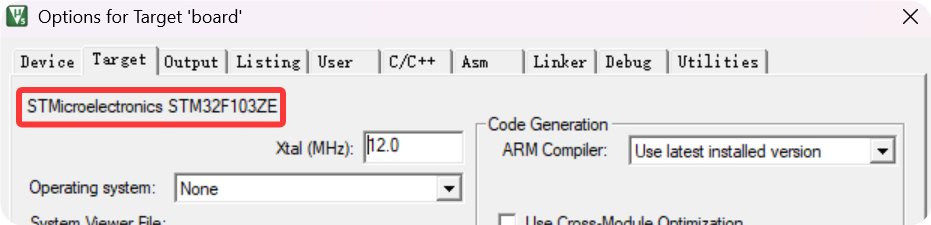
>
> **【截图 1-2】** VSCode 资源管理器：`demo-register/` 目录树（boot / hardware / system / user / project）
>
> 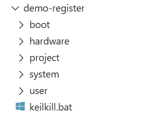
>
> **【截图 1-3】**
>
> 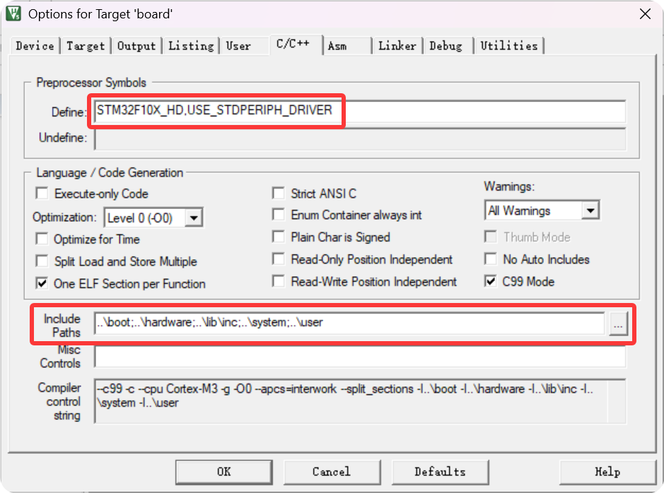
>
> **【截图 1-4】**
>
> 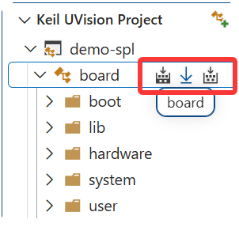

#### 1.2.2 工程结构

```text
demo-register/
├── boot/            CMSIS 内核 core_cm3.c、设备头 stm32f10x.h、system_stm32f10x.c、
│                    启动文件 startup_stm32f10x_hd.s、中断入口 stm32f10x_it.c
├── hardware/        devices_led.c / devices_led.h   ← 本作业新增的 LED 驱动
├── system/          system_delay.c（SysTick 轮询延时）、system_option.c（NVIC 分组）
├── user/            main.c                          ← 应用入口
└── project/         hw1-register.uvprojx / .uvoptx、DebugConfig/
```

#### 1.2.3 关键代码

**`hardware/devices_led.c`** —— 全部操作都直接读写寄存器：

```c
#include "devices_led.h"

/* ---- 硬件抽象：换引脚只需改这三行 ---- */
#define LED_GPIO        GPIOA               /* LED 所在端口 */
#define LED_CRH_POS     0U                  /* PA8 -> CRH 的 bit3:0 */
#define LED_CRH_MASK    (0xFUL << LED_CRH_POS)

#define LED_BS8         (1UL << 8)          /* BSRR 置位位  */
#define LED_BR8         (1UL << 24)         /* BSRR 复位位（BSRR 高 16 位）*/
#define LED_ODR_MASK    (1UL << 8)          /* ODR 中 PA8 对应的位 */

void led_init(void)
{
    /* 1) 使能 GPIOA 时钟（GPIO 挂 APB2） */
    RCC->APB2ENR |= RCC_APB2ENR_IOPAEN;

    /* 2) 清 PA8 旧配置，再写入 0011（推挽输出、50MHz） */
    LED_GPIO->CRH &= ~LED_CRH_MASK;
    LED_GPIO->CRH |=  (0x3UL << LED_CRH_POS);

    /* 3) 初始输出高电平，灯亮 */
    LED_GPIO->BSRR = LED_BS8;
}

void led_on(void)  { LED_GPIO->BSRR = LED_BS8; }   /* 置位 ODR8，原子操作 */
void led_off(void) { LED_GPIO->BSRR = LED_BR8; }   /* 复位 ODR8，原子操作 */

void led_toggle(void)                              /* 读 ODR 判断电平后取反 */
{
    if ((LED_GPIO->ODR & LED_ODR_MASK) != 0U) { LED_GPIO->BSRR = LED_BR8; }
    else                                      { LED_GPIO->BSRR = LED_BS8; }
}
```

**`user/main.c`**：

```c
#include "stm32f10x.h"
#include "system_delay.h"
#include "system_option.h"
#include "devices_led.h"

int main(void)
{
    system_delay_init(72);      /* SysTick 延时初始化，主频 72MHz */
    led_init();                 /* PA8 推挽输出，初始点亮 */

    while (1)
    {
        led_toggle();           /* 翻转一次 */
        system_delay_ms(500);   /* 间隔 500ms，形成 1Hz 闪烁 */
    }
}
```

#### 1.2.4 寄存器层面的三个知识点

| 寄存器 | 位 | 作用 | 本实验取值 |
|---|---|---|---|
| `RCC->APB2ENR` | bit2 `IOPAEN` | GPIOA 时钟使能 | `1`（必须先开时钟，否则写 CRH 无效） |
| `GPIOA->CRH` | bit3:0 | PA8 的 MODE[1:0] + CNF[1:0] | `0b0011` = 输出 50 MHz + 通用推挽 |
| `GPIOA->BSRR` | bit8 / bit24 | 置 1 / 清 0，**原子操作**，不受中断打断 | 写 1 点亮、写 bit24 熄灭 |

为什么用 `BSRR` 而不是 `ODR ^= ...`？因为 `ODR` 的读-改-写需要三条指令，中途被中断打断就可能改写别的引脚；`BSRR` 单次写入即可完成置位/复位，天然原子。

### 1.3 标准外设库方式（SPL）

#### 1.3.1 搭建流程

1~3 步与寄存器方式相同（新建工程、选器件）。差别在第 3 步的运行环境勾选：需要勾 `Device → StdPeriph Drivers`，或者把 ST 官方 **SPL V3.5.0** 的 `Libraries/STM32F10x_StdPeriph_Driver/{inc,src}` 整个拷进工程。

4. **建立目录**：`boot/`、`lib/inc`、`lib/src`（SPL 全部源码）、`hardware/`、`system/`、`user/`。
5. **添加文件**：`boot` 组放 CMSIS + 启动文件；`lib` 组至少加入本工程用到的 **`stm32f10x_gpio.c`、`stm32f10x_rcc.c`**（教学模板为方便实验把 SPL 全套 22 个 `.c` 都加进去，实际编译时链接器会按需裁剪）。
6. **配置编译选项**：`Define` 填 **`STM32F10X_HD, USE_STDPERIPH_DRIVER`**（后者让 `stm32f10x.h` 自动包含 `stm32f10x_conf.h`），`Include Paths` 增加 `..\lib\inc`。
7. **确认 `stm32f10x_conf.h`** 中 `#include "stm32f10x_gpio.h"`、`"stm32f10x_rcc.h"` 没有被注释掉。
8. **VSCode 中写代码**：`devices_led.c` 换成 SPL API 版本（1.3.2），`main.c` 与寄存器版完全一致。
9. **编译下载**：Keil Assistant 面板 `Build` → `Download`。

> **【截图 1-5】**
>
> 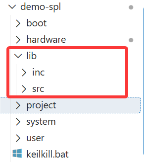
>
> **【截图 1-6】** 
>
> 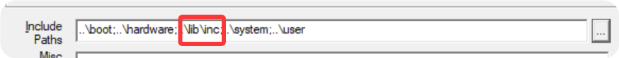

#### 1.3.2 关键代码

**`hardware/devices_led.c`** —— 把寄存器位运算换成"填结构体 + 调函数"：

```c
#include "devices_led.h"

/* ---- 硬件抽象：换引脚只需改这三行 ---- */
#define LED_GPIO_PORT   GPIOA
#define LED_GPIO_PIN    GPIO_Pin_8
#define LED_GPIO_CLK    RCC_APB2Periph_GPIOA

void led_init(void)
{
    GPIO_InitTypeDef GPIO_InitStructure;    /* SPL 用结构体传递参数 */

    /* 1) 使能 GPIOA 时钟 */
    RCC_APB2PeriphClockCmd(LED_GPIO_CLK, ENABLE);

    /* 2) 填入参数：PA8、推挽输出、50MHz */
    GPIO_InitStructure.GPIO_Pin   = LED_GPIO_PIN;
    GPIO_InitStructure.GPIO_Mode  = GPIO_Mode_Out_PP;   /* 通用推挽输出 */
    GPIO_InitStructure.GPIO_Speed = GPIO_Speed_50MHz;   /* 输出速度 50MHz */
    GPIO_Init(LED_GPIO_PORT, &GPIO_InitStructure);

    /* 3) 初始输出高电平，灯亮 */
    GPIO_SetBits(LED_GPIO_PORT, LED_GPIO_PIN);
}

void led_on(void)  { GPIO_SetBits(LED_GPIO_PORT, LED_GPIO_PIN); }
void led_off(void) { GPIO_ResetBits(LED_GPIO_PORT, LED_GPIO_PIN); }

void led_toggle(void)
{
    if (GPIO_ReadOutputDataBit(LED_GPIO_PORT, LED_GPIO_PIN) != Bit_RESET)
        GPIO_ResetBits(LED_GPIO_PORT, LED_GPIO_PIN);
    else
        GPIO_SetBits(LED_GPIO_PORT, LED_GPIO_PIN);
}
```

`main.c` 与寄存器方式**逐字相同**（都只调 `led_init / led_toggle / system_delay_ms`）——这正是封装的价值。

#### 1.3.3 三种调用与寄存器的一一对应

| SPL 函数 | 内部最终做的事 | 对应寄存器操作 |
|---|---|---|
| `RCC_APB2PeriphClockCmd(RCC_APB2Periph_GPIOA, ENABLE)` | 置位 APB2ENR | `RCC->APB2ENR \|= 1<<2` |
| `GPIO_Init(GPIOA, &结构体)` | 按 Pin/Mode/Speed 计算并写 CRL/CRH | `GPIOA->CRH = (GPIOA->CRH & ~0xF) \| 0x3` |
| `GPIO_SetBits / GPIO_ResetBits` | 写 BSRR | `GPIOA->BSRR = 0x100 / 0x1000000` |
| `GPIO_ReadOutputDataBit` | 读 ODR 取位 | `(GPIOA->ODR >> 8) & 1` |

`GPIO_Init()` 里还做了模式查表：把 `GPIO_Mode_Out_PP`（枚举值 0x10）+ `GPIO_Speed_50MHz`（枚举值 3）组合成 4 位配置字，再按引脚号算出应该写 CRL 还是 CRH、左移几位。这部分"位运算的脏活"就是 SPL 帮我们封装掉的内容。

### 1.4 硬件抽象库方式（HAL）

#### 1.4.1 搭建流程

HAL 工程一般由 **STM32CubeMX** 图形化生成，也可以直接用配套的 HAL 模板：

1. **新建 CubeMX 工程**：`File → New Project`，在 `Part Number` 搜索 `STM32F103ZET` 并双击选中。
2. **配置时钟**：`RCC → HSE = Crystal/Ceramic Resonator`（外部 8 MHz 晶振）；`Clock Configuration` 页把 PLL Source 选 HSE、PLLMul 选 ×9，SYSCLK 填 72 MHz 回车让其自动求解分频（AHB=72 MHz，APB1=36 MHz，APB2=72 MHz）。
3. **配置 GPIO**：在芯片图上点 **PA8**，选 `GPIO_Output`；在 `System Core → GPIO → PA8` 中把 `GPIO output level` 设为 **High**、`GPIO mode` 设为 `Output Push Pull`、`Maximum output speed` 设为 `Low`、`User Label` 填 `LED`（这样生成的宏就叫 `LED_Pin` / `LED_GPIO_Port`）。
4. **调试接口**：`SYS → Debug = Serial Wire`（保留 SWD，释放 PA13/PA14 以外的 JTAG 引脚）。
5. **生成代码**：`Project Manager` 中 `Toolchain/IDE` 选 **MDK-ARM V5**，工程名 `hw1-hal`，点 `GENERATE CODE`。
6. **打开工程**：用 Keil 打开 `MDK-ARM/hw1-hal.uvprojx` 核对 `Define` 为 `USE_HAL_DRIVER, STM32F103xE`；随后在 VSCode 里 `打开文件夹` 选 `hw1-hal/`，Keil Assistant `Add Project` 选该 `.uvprojx`。
7. **写应用逻辑**：生成的 `main.c` 中 `MX_GPIO_Init()` 已完成 PA8 初始化，业务代码写在 `/* USER CODE BEGIN */` 与 `/* USER CODE END */` 之间（重生成代码不会丢失）；在 VSCode 里改 `Src/app.c` 的 `APP_BLINK_PERIOD_MS` 与 `app_poll()`。
8. **编译下载**：Keil Assistant 面板 `Build` → `Download`。

> **【截图 1-7】**
>
> 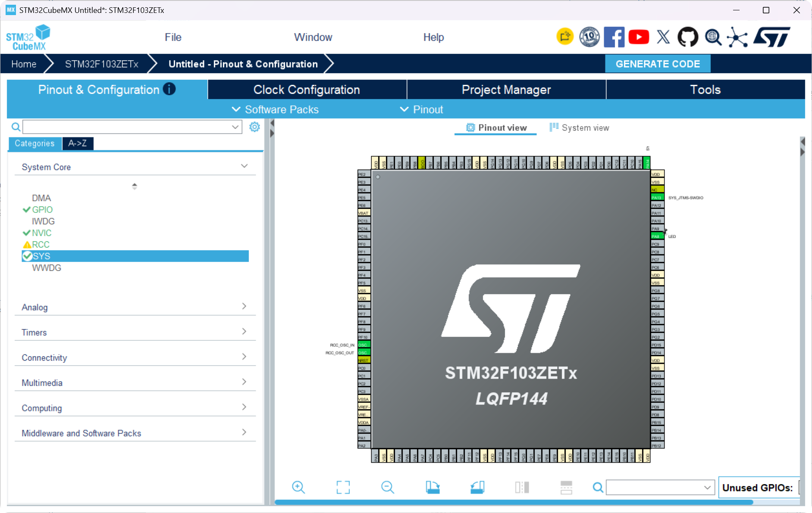
>
> **【截图 1-8】**
>
> 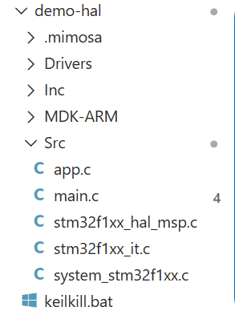

#### 1.4.2 关键代码

**`Inc/main.h`**（CubeMX 生成，User Label 自动变成宏）：

```c
//PA8->LED（高电平点亮）
#define LED_Pin GPIO_PIN_8
#define LED_GPIO_Port GPIOA
```

**`Src/main.c` 的 `MX_GPIO_Init()`**：

```c
static void MX_GPIO_Init(void)
{
  GPIO_InitTypeDef GPIO_InitStruct = {0};

  /* GPIO Ports Clock Enable */
  __HAL_RCC_GPIOA_CLK_ENABLE();          /* 等价于 RCC->APB2ENR |= IOPAEN */

  /* 先定初始电平，再配置引脚，避免上电瞬间闪一下 */
  HAL_GPIO_WritePin(LED_GPIO_Port, LED_Pin, GPIO_PIN_SET);

  GPIO_InitStruct.Pin   = LED_Pin;
  GPIO_InitStruct.Mode  = GPIO_MODE_OUTPUT_PP;
  GPIO_InitStruct.Pull  = GPIO_NOPULL;
  GPIO_InitStruct.Speed = GPIO_SPEED_FREQ_LOW;
  HAL_GPIO_Init(LED_GPIO_Port, &GPIO_InitStruct);
}
```

**`Src/app.c`**（应用层，`main()` 只调用 `app_init()` / `app_poll()`）：

```c
#define APP_BLINK_PERIOD_MS  500U          /* LED 翻转周期(ms) */

void app_init(void)
{
  printf("Template-HAL ready, 72MHz, blink every %u ms\r\n", (unsigned)APP_BLINK_PERIOD_MS);
  s_last_tick = HAL_GetTick();
}

void app_poll(void)                        /* 主循环里反复调用，非阻塞 */
{
  uint32_t now = HAL_GetTick();
  if (now - s_last_tick >= APP_BLINK_PERIOD_MS)
  {
    s_last_tick = now;
    HAL_GPIO_TogglePin(LED_GPIO_Port, LED_Pin);   /* PA8 翻转 */
    printf("tick %u\r\n", (unsigned)now);
  }
}
```

注意 HAL 版的延时不再是 `system_delay_ms()`，而是 `HAL_GetTick()`：SysTick 中断里 `HAL_IncTick()` 累加一个全局毫秒计数，`HAL_Delay()` 只是"死等这个计数变化"。**所以 `stm32f1xx_it.c` 里的 `SysTick_Handler()` 必须存在且调用 `HAL_IncTick()`**，否则 `HAL_Delay()` 会永久卡死——这是 HAL 入门最常踩的坑。

### 1.5 三种方式实测对比

三个工程都用与 `.uvprojx` 完全相同的宏定义、头文件路径和优化选项，交给 **Keil 自带的 ARMCC（AC5）逐文件编译 + armlink 链接**，结果如下（数据来自实际构建产物 `fromelf` 统计，不是估算）：

| 方式 | 工程内 C 文件数 | Code | RO-data | RW-data | ZI-data | **Flash 占用** | **RAM 占用** |
|---|---|---|---|---|---|---|---|
| 寄存器 Register | 7 | 952 | 336 | 8 | 1632 | **1296 B** | 1640 B |
| 标准库 SPL | 30 | 1296 | 336 | 8 | 1632 | **1640 B** | 1640 B |
| 硬件库 HAL | 17 | 3876 | 380 | 24 | 1096 | **4280 B** | 1120 B |

> 说明：寄存器/SPL 工程沿用模板默认的"标准 C 库 + -O0"，HAL 工程沿用模板默认的"MicroLIB + -O3"；寄存器/SPL 的 ZI-data 中包含启动文件预留的 1 KB 栈与 512 B 堆（HAL 用 MicroLIB，不再单独预留堆）。即便 HAL 用了更高优化等级和更省空间的 MicroLIB，代码量仍约为寄存器方式的 **4 倍**——这部分开销就是抽象层的代价。

三条路线的"抽象层级"可以用一句话概括：**越往下，代码越短、越贴近硬件、越难移植；越往上，代码越长、越易读、越容易换芯片。**

### 1.6 优缺点与适用场景

| | 寄存器方式 | SPL 标准外设库 | HAL 硬件抽象库 |
|---|---|---|---|
| **本质** | 直接读写 `RCC/GPIO/...` 寄存器 | 对寄存器做函数级封装 | 面向"外设对象/句柄"的跨系列封装 |
| **优点** | ① 代码量最小、执行效率最高<br>② 不依赖任何库，无版本兼容问题<br>③ 逼着你看参考手册，最懂硬件 | ① 函数名即功能，可读性大幅提升<br>② 仍贴近寄存器，调试时能对上手册<br>③ 老工程/教材资料最多 | ① 一套 API 通吃 F0/F1/F4/L4…<br>② CubeMX 图形配置，生成即用<br>③ 自带超时、状态机、错误码 |
| **缺点** | ① 可读性差，位运算易错<br>② 换芯片/换引脚要重写<br>③ 无参数检查，错了很难查 | ① 只覆盖 STM32F1，跨系列不可用<br>② ST 已停止维护（V3.5.0 是终版）<br>③ 无超时/错误处理机制 | ① 代码臃肿、Flash 占用大<br>② 层层封装，出问题难定位<br>③ 版本/包依赖管理麻烦（Cube 包、DFP） |
| **典型场景** | 教学打基础、Bootloader、时序敏感驱动（软件 SPI/I2C）、极致成本项目、老工程师维护的存量代码 | 维护 2015 年前后的存量 F1 工程、教学实验（既想看寄存器又不想写位运算） | 新产品开发、快速原型、多系列复用、带 RTOS/USB/文件系统的复杂项目、团队协作 |
| **建议** | 先学 | 了解即可 | 工作主力 |

### 1.7 实验现象与验证说明

**预期现象**：上电后 PA8 上的 LED 先亮 500 ms，熄灭 500 ms，如此循环；用示波器/逻辑分析仪测 PA8 可看到 1 Hz、占空比 50% 的方波（高电平 3.3 V）。

**本作业的验证边界（如实说明）**：

- ✅ 三个工程已用 Keil 的 ARMCC 编译器按工程自身的宏/包含路径**逐文件编译并成功链接**，`0 error`，生成的 `.axf/.hex` 与上表尺寸一致；
- ✅ LED 初始化涉及的寄存器位（APB2ENR bit2、CRH bit3:0、BSRR bit8/bit24）已逐条与《STM32F10x 参考手册》RM0008 核对；
- ⚠️ **未在真实硬件上烧录验证**——本机 Keil `UV4.exe` 需要管理员权限才能命令行编译，因此 VSCode 里点 Build/Download 与下载运行需由本人在实验箱上完成，对应的运行截图见附录 B 清单。

---

## 二、RISC 与 CISC

CPU 说到底只会做一件事——按指令干活。而"指令长什么样、能有多复杂"，历史上有两条完全相反的路线。

### 2.1 CISC（Complex Instruction Set Computer，复杂指令集）

早期的计算机内存又贵又小、编译器还很原始，程序员希望**一条指令能干尽量多的活**，于是指令系统不断膨胀，出现了"存储器直接参与运算""一条指令完成数组搬运"这类复杂指令，这就是 CISC。

**核心特征**：

- 指令**长度不定**（x86 一条指令 1~15 字节），格式多、编码复杂；
- **寻址方式多**（x86 有十几种），指令可以直接对内存操作数做运算；
- 指令**执行周期长短不一**，多数由**微程序（microcode）**解释执行；
- 通用寄存器数量较少，很多操作要经过内存；
- 遵循"**二八原则**"：20% 的简单指令承担了 80% 的使用频率，剩下 80% 的复杂指令很少被用到；
- 典型代表：**Intel/AMD 的 x86 系列**（i7-14700、R7-7800）、早期的 VAX/PDP-11。

### 2.2 RISC（Reduced Instruction Set Computer，精简指令集）

RISC 的思路正相反：**只保留最常用、最规整的指令**，把复杂功能交给"多条简单指令的组合"，用编译器去优化。

**核心特征**：

- 指令**定长**（ARM 的 A32 是 32 位、Thumb 是 16 位、Thumb-2 是 16/32 位混合），字段划分规整，译码简单；
- **Load/Store 结构**：只有 `LDR/STR` 能访问内存，运算指令一律在寄存器之间进行；
- 通用寄存器多（Cortex-M3 有 R0–R12 共 13 个通用寄存器）；
- 绝大多数指令**单周期**完成，控制器用**硬布线逻辑**实现，天然适合**流水线**；
- 典型代表：**ARM 系列**（Cortex-M3/M4/A78）、MIPS、RISC-V、PowerPC。

### 2.3 区别对比

| 对比项 | CISC | RISC |
|---|---|---|
| 指令数量 | 多（几百条） | 少（几十~一百多条） |
| 指令长度 | 变长、格式多 | 定长、格式规整 |
| 寻址方式 | 多且复杂，可直接访存 | 少，只有 Load/Store 访存 |
| 执行周期 | 差异大，微程序控制为主 | 基本单周期，硬布线控制为主 |
| 通用寄存器 | 较少 | 较多 |
| 流水线 | 难做、效率低 | 易做、效率高 |
| 代码密度 | 高（程序小） | 较低（Thumb-2 已大幅改善） |
| 编译器压力 | 小 | 大（要靠编译器调度流水线） |
| 功耗 | 高 | 低 |
| 代表 | x86 / x86-64 | ARM、RISC-V、MIPS |

### 2.4 优缺点

**RISC 的优点**：① 指令规整，译码和流水线简单，容易做到高主频、低功耗，这正是手机能塞进指甲盖大小芯片的原因；② 晶体管主要花在寄存器、Cache、流水线上，而不是复杂的译码器；③ 定长指令让取指边界确定，分支预测和乱序执行更容易实现。

**RISC 的缺点**：① 完成同样的功能需要更多条指令，**代码密度低**（早期 ARM 程序比 x86 大 30% 以上，Thumb/Thumb-2 就是为解决这个问题而生）；② 对编译器优化能力依赖大，编译器差则性能差；③ 生态相对薄弱（x86 的软件不能直接跑）。

**CISC 的优点**：① 单条指令功能强，**代码密度高**，在内存昂贵的年代意义重大；② 访存次数少，减少内存访问开销；③ **向后兼容性极好**，几十年前的 x86 程序今天还能跑，Windows 生态由此建立。

**CISC 的缺点**：① 指令长短不一，难以流水线化，译码器复杂、晶体管开销大；② 微程序执行慢，复杂指令往往要十几个周期；③ 功耗高，不适合电池供电的嵌入式设备。

**融合趋势**：今天的 x86 内部其实是"**CISC 外壳 + RISC 内核**"——CPU 前端把变长的 x86 指令解码成定长的 **μops（微操作）**，再交给类 RISC 的执行单元；而 ARM 的 Thumb-2 也把 16 位与 32 位指令混用，兼顾代码密度与性能。可见 RISC 与 CISC 的界限已越来越模糊，**"指令集是给编译器看的接口"**才是本质。

> STM32F103 用的 Cortex-M3 属于 RISC，指令集是 **Thumb-2**：16 位指令负责常用操作（代码密度接近 CISC），32 位指令负责复杂操作（性能接近 RISC），是两种思想折中的产物。

---

## 三、哈佛架构与冯·诺依曼架构

这里的"架构"指的**不是指令集，而是 CPU 与存储器的连接方式**。

### 3.1 冯·诺依曼架构（von Neumann / 普林斯顿架构）

1945 年由冯·诺依曼提出，核心思想是"**存储程序**"：程序（指令）和数据用**同一种二进制形式**存放在**同一个存储器**里，CPU 通过**同一组总线**去取指令或取数据，二者**统一编址**。

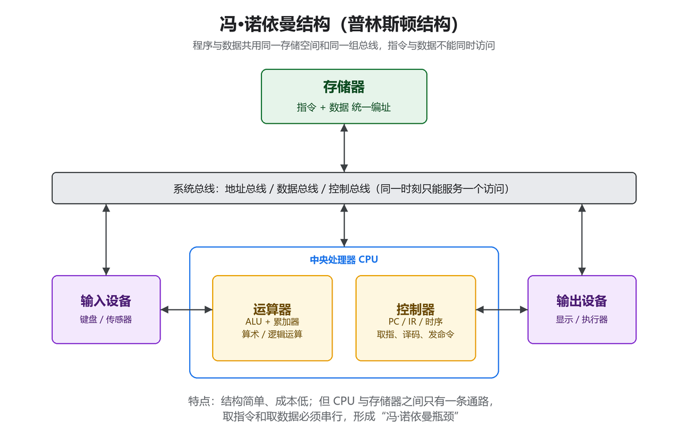

*图 3-1　冯·诺依曼结构：指令与数据共用存储器与总线*

**优点**：结构简单、器件少、成本低；指令与数据统一编址，程序可以像数据一样被读写（这正是"程序可修改""操作系统能加载程序"的基础）。

**缺点**：CPU 与存储器之间只有一条通路，**取指令和取数据必须串行**，形成著名的"**冯·诺依曼瓶颈**"——CPU 越快，越是被内存带宽拖住。

### 3.2 哈佛架构（Harvard Architecture）

> 课件中写作"哈弗体系结构"，"哈佛/哈弗"是同一种架构的不同译名，英文均为 Harvard。

哈佛架构把**指令存储器**和**数据存储器**在物理上彻底分开，各自配一套地址总线与数据总线。CPU 取指令走"指令总线"，读写数据走"数据总线"，两条通路可以**同时工作**。

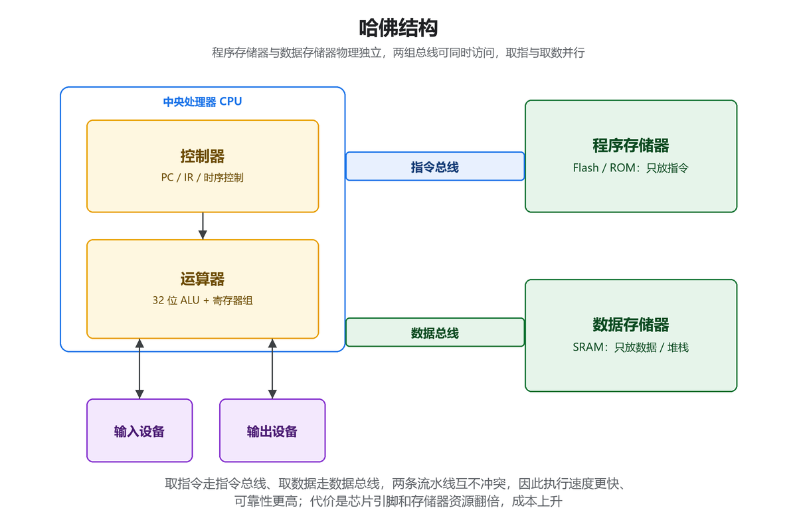

*图 3-2　哈佛结构：指令与数据各有独立存储器与总线*

**优点**：取指与取数并行，**执行速度更快**；指令区与数据区物理隔离，程序不会被误写，**可靠性更高**；指令字长与数据字长可以不同，便于针对各自优化。

**缺点**：需要两套存储器与两组总线，**硬件成本高、引脚多**；指令与数据无法共享存储空间，**灵活性差**；若两者容量分配不当会造成浪费。

### 3.3 两者对比

| 对比项 | 冯·诺依曼架构 | 哈佛架构 |
|---|---|---|
| 存储器 | 指令与数据共用一个 | 指令与数据分开独立 |
| 总线 | 一组（地址/数据/控制） | 两组（指令总线 + 数据总线） |
| 地址空间 | 统一编址 | 分开编址（或统一编址但物理分离） |
| 取指与取数 | 必须串行 | 可以并行 |
| 速度 | 受限于总线带宽（瓶颈） | 更快 |
| 成本/引脚 | 低 / 少 | 高 / 多 |
| 灵活性 | 高（程序可当数据处理） | 较低 |
| 典型应用 | PC（x86）、通用计算机 | 单片机、DSP（早期 8051 程序与数据空间分离） |

### 3.4 STM32 属于哪一种？

**Cortex-M3 内核是"改进型哈佛结构"**：

- **从内核看是哈佛**：内核有独立的 **ICode 总线**（取指令）、**DCode 总线**（取常量/数据）和 **System 总线**（访问外设），三条总线通过总线矩阵并行工作；
- **从程序员看是冯·诺依曼**：Flash、SRAM、外设被映射到**同一个 4 GB 线性地址空间**（`0x08000000` 起是 Flash，`0x20000000` 起是 SRAM，`0x40000000` 起是外设），用普通指针就能访问，不需要区分"程序段"和"数据段"。

所以 STM32 兼顾了哈佛的"快"和冯·诺依曼的"好用"，这也是现代 MCU 的普遍做法。

---

## 四、Cortex-M3 处理器结构框图及各部件介绍

Cortex-M3 是 ARM 公司设计的 32 位 RISC 处理器**内核**（IP 核），ST 公司把它和 Flash、SRAM、GPIO、USART 等片上外设集成在一起，才成为 STM32F103 芯片。

看这张图要抓住一条边界：**"CPU 内核"与"总线接口"之间是 ARM 的地盘，"总线接口"以外是芯片厂商（ST）的地盘**。内核负责取指、译码、执行、响应中断；总线接口负责把内核的访问请求送到片上的 Flash、SRAM 和外设。

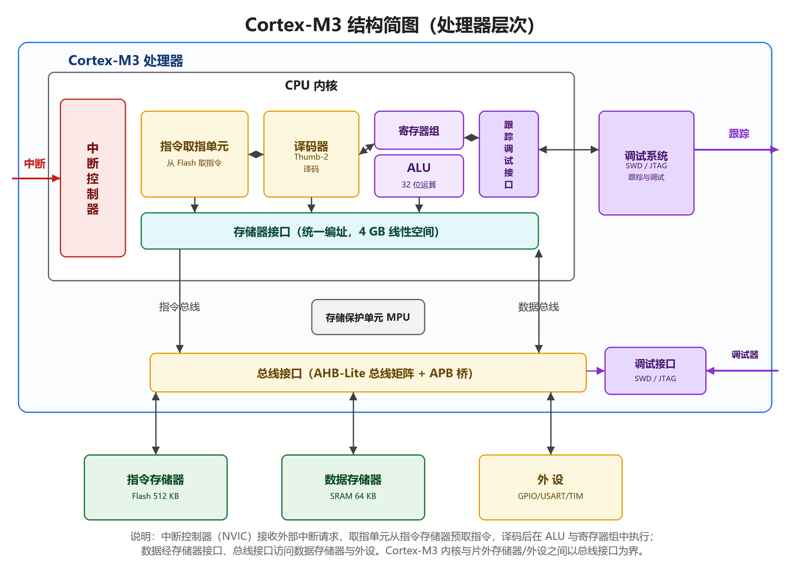

*图 4-1　Cortex-M3 结构简图（处理器层次：内核 → 存储器接口 → 总线接口 → 存储器/外设）*

### 4.1 CPU 内核内部部件

| 部件 | 作用 |
|---|---|
| **中断控制器（NVIC）** | 接收外部中断请求（图中左侧红色"中断"箭头），按优先级排队并通知内核；支持嵌套与动态改优先级。详见 4.3 节 |
| **指令取指单元** | 按 PC 的值从**指令存储器**（Flash）预取指令，每周期可取出 1~2 条 16 位指令；遇到跳转时清空已预取的错误指令 |
| **译码器** | 把取回的机器码翻译成控制信号。Cortex-M3 用 **Thumb-2** 译码器，同时识别 16 位与 32 位指令，因此不需要在 ARM/Thumb 两种状态间切换（Cortex-M 永远处于 Thumb 状态） |
| **寄存器组** | R0–R15 通用寄存器 + 特殊寄存器，是运算数据的暂存处，详见第九题 |
| **ALU（算术逻辑单元）** | 完成加减、逻辑、移位、比较等 32 位运算，并产生 N/Z/C/V 条件标志供跳转判断 |
| **存储器接口** | 内核与总线之间的"出口"：把取指、取数、写回请求打包成总线事务，并完成地址译码（统一编址的 4 GB 空间） |
| **跟踪调试接口** | 把内核内部执行信息送给片上的调试系统（DWT/ITM/ETM），供调试器观察 |

> 注：早期教材常把这一块画成"取指—译码—执行"三部分；本图按课堂讲授的层次，把取指、译码、寄存器组、ALU、存储器接口分别画出，便于逐个对应部件功能。

### 4.2 三级流水线

Cortex-M3 采用**三级流水线**，同一时刻三条指令分别处于三个阶段：

| 流水级 | 做什么 | 用到的部件 |
|---|---|---|
| **① 取指（Fetch）** | 从存储器或缓存中把指令读出来 | 指令取指单元、指令总线（I-Code） |
| **② 译码（Decode）** | 把机器码翻译成"要做什么操作、操作哪个寄存器" | 译码器 |
| **③ 执行（Execute）** | 真正做运算、访存、写回结果 | ALU、寄存器组、存储器接口 |

流水线的意义是**重叠**：第 N 条指令在执行时，第 N+1 条正在译码、第 N+2 条正在取指，因此理想情况下**每个时钟周期完成一条指令**（CPI≈1）。

代价是**跳转要冲刷流水线**：程序一旦分支，已经预取的两条指令就作废了，需要重新取指，这就是"分支延迟"。Cortex-M3 用两条措施缓解：① 指令总线是 32 位宽，一次可以取出两条 16 位指令；② 内置简单的**分支预测**，对 `B`、`BL` 之类跳转提前预取目标地址。

> 练习方法：在 Keil 里单步调试（F11）时打开 `Disassembly` 窗口，能看到 PC 每次前进 2 字节（16 位指令）或 4 字节（32 位指令）——这就是流水线在"喂"指令。

### 4.3 内核中的"系统"部件

| 部件 | 全称 | 作用 |
|---|---|---|
| **NVIC** | Nested Vectored Interrupt Controller，嵌套向量中断控制器 | Cortex-M3 的"中枢神经"。最多支持 **240 个外设中断 + 16 个内核异常**；每个中断有独立优先级，支持**分组与嵌套**（高优先级可打断低优先级中断）；中断发生时硬件**自动压栈/出栈** 8 个寄存器（R0–R3、R12、LR、PC、xPSR），响应延迟最短仅 **12 个周期**；配合 VTOR 可实现中断向量表重定位（Bootloader 跳转用） |
| **SysTick** | 系统节拍定时器 | 24 位递减计数器，可产生周期性中断。裸机用它做 `HAL_Delay()` 的毫秒基准，跑 RTOS 时用它做**系统节拍（tick）**，是"操作系统心跳" |
| **MPU** | Memory Protection Unit，存储器保护单元 | **可选**部件（图中画在存储器接口与总线接口之间），把 4 GB 地址空间划分为最多 8 个区域，为每个区域设定读/写/执行权限。让 RTOS 能把非法访问（如空指针写、任务越界）变成一次异常，而不是死机 |
| **FPB** | Flash Patch and Breakpoint，闪存地址重载与断点单元 | 内含地址比较器，可在**不改 Flash 内容**的前提下把某段代码"重映射"到 SRAM（打补丁），也是硬件断点的实现基础 |
| **DWT** | Data Watchpoint and Trace，数据观察点与跟踪单元 | 监视指定地址的读写，可统计指令周期数、睡眠周期数，是**性能分析（CPI、中断响应时间）**的硬件工具 |
| **ITM** | Instrumentation Trace Macrocell，指令跟踪宏单元 | 一条"调试专用串口"：程序里写 `ITM_SendChar()` 就能把信息送到调试器，**不占用 USART 引脚**，也不影响实时性 |
| **TPIU** | Trace Port Interface Unit，跟踪端口接口单元 | 把 ITM/DWT/ETM 的跟踪数据打包，通过 1/2/4 位并行跟踪端口送出芯片外，是 SWO 输出的出口 |
| **ETM** | Embedded Trace Macrocell，嵌入式跟踪宏单元 | **可选**部件，完整记录指令执行流，用于深度调试。STM32F103 系列一般不带 ETM，日常调试用 ITM + SWO 即可 |

> 这些部件都挂在 **0xE0000000** 起的"**私有外设总线（PPB）**"上，属于内核私有，不占用户的片内外设地址。

### 4.4 总线接口与存储器映射

Cortex-M3 的总线不是一个"大总线"，而是按用途分成几组（这也是"哈佛结构"在内核层面的体现）：

| 总线 | 名称 | 连接对象 | 说明 |
|---|---|---|---|
| **I-Code** | 指令存储区总线 | 从 `0x00000000`–`0x1FFFFFFF` 的指令空间（即 Flash） | 专门取指令，与 D-Code 互不干扰 |
| **D-Code** | 数据存储区总线 | 同一片 Flash 区，用于**查表、取常量** | 与 I-Code 并行，避免"取指令时取不了常量" |
| **System** | 系统总线 | SRAM（`0x20000000`）、片上外设（`0x40000000`）、外部设备 | 访问变量与外设寄存器 |
| **PPB** | 私有外设总线 | `0xE0000000` 起的 NVIC/SysTick/ITM/DWT/FPB/MPU | 内核自己的"内部总线"，速度要求不高 |
| **外部 PPB** | 调试访问端口总线 | 调试接口 ↔ 调试系统 | 让调试器能读写内核寄存器与存储器 |

整个 4 GB 空间被划成固定区域，这套划分叫**存储器映射**：

| 地址范围 | 区域 | STM32F103ZET6 的用途 |
|---|---|---|
| `0x00000000`–`0x1FFFFFFF` | Code（代码区） | 别名到 Flash `0x08000000`；复位时从这里取向量表 |
| `0x20000000`–`0x3FFFFFFF` | SRAM | 64 KB 片内 SRAM |
| `0x40000000`–`0x5FFFFFFF` | 外设 | APB1/APB2/AHB 外设寄存器 |
| `0x60000000`–`0x9FFFFFFF` | 外部 RAM | FSMC 扩展 SRAM/NOR/NAND |
| `0xA0000000`–`0xDFFFFFFF` | 外部设备 | FSMC 扩展 LCD 等 |
| `0xE0000000`–`0xFFFFFFFF` | 内核私有外设 | NVIC、SysTick、ITM、DWT、FPB、MPU、SCB |

> **位带（Bit-Band）**：Cortex-M3 还提供了两个 32 MB 的"位带别名区"，把 SRAM 的 1 MB 和外设的 1 MB 按"1 位 = 1 个字"映射过去，做到**单个 bit 的原子读写**——这就是为什么写 `GPIOA->ODR` 的某一位可以不用读-改-写。

### 4.5 片外部分（ST 公司添加）

| 部件 | 在 STM32F103ZET6 中的体现 |
|---|---|
| Flash 存储器 | 512 KB，起始地址 `0x08000000`，存程序和常量（只读，擦写需按页/扇区） |
| SRAM | 64 KB，起始地址 `0x20000000`，存全局变量、堆、栈 |
| AHB 外设 | DMA 控制器、FSMC（外部存储器接口）、SDIO、以太网（部分型号）等 |
| APB 外设 | GPIOA–GPIOG、USART1–5、TIM1–8、I2C1/2、SPI1/2/3、ADC1–3、CAN、USB、RTC、看门狗等 |

### 4.6 更详细的结构框图

上面那张简图适合讲清"谁属于内核、谁属于芯片"，而 ARM 官方的**详细结构框图**把内核里的调试组件、总线矩阵都摊开了，两图对照看更完整：

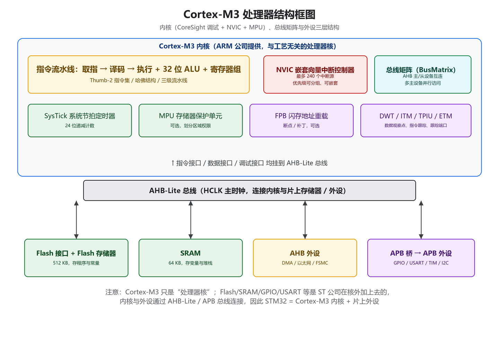

*图 4-2　Cortex-M3 处理器详细结构框图（内核 + CoreSight 调试组件 + 总线矩阵 + 外设）*

### 4.7 一句话总结

**Cortex-M3 = RISC 内核 + NVIC/SysTick/MPU + 调试跟踪部件 + 总线矩阵**；**STM32 = Cortex-M3 + Flash/SRAM + 片上外设 + 电源时钟复位电路**。理解了这条边界，就明白为什么同一个 Cortex-M3 内核可以被 ST、NXP、TI 做出完全不同的芯片——外设和存储器是各家自己加的。

---

## 五、嵌入式系统的定义与组成

### 5.1 定义

**嵌入式系统（Embedded System）** 是指**以应用为中心、以计算机技术为基础、软硬件可裁剪，能够适应应用系统对功能、可靠性、成本、体积、功耗有严格要求的专用计算机系统**。

这个定义包含四层意思：

1. **以应用为中心**——它是为某个具体产品服务的，不是通用计算机，"够用就好"；
2. **以计算机技术为基础**——本质仍是"处理器 + 存储器 + 软件"的计算机系统，只是被"嵌入"到设备内部；
3. **软硬件可裁剪**——同一颗芯片可以只用一个 GPIO，也可以跑 RTOS + GUI，按需取舍；
4. **有严格约束**——功耗、体积、成本、实时性、可靠性往往比"绝对性能"更重要。

### 5.2 主要特点

| 特点 | 说明 |
|---|---|
| 专用性强 | 面向特定任务，软硬件紧耦合，通常不做通用计算 |
| 实时性要求 | 硬实时系统必须在**确定的时限内**响应（如安全气囊必须在毫秒级引爆），超时即失败 |
| 资源受限 | 处理器主频低、存储小、无磁盘、无大屏，代码要精打细算 |
| 高可靠性与稳定性 | 常年在无人值守环境下运行，需看门狗、掉电检测、异常复位等机制 |
| 低功耗 | 电池供电设备要求待机电流 μA 级，需要多级休眠与唤醒 |
| 生命周期长 | 工业与汽车产品往往要求供货与维护 10 年以上 |

### 5.3 组成

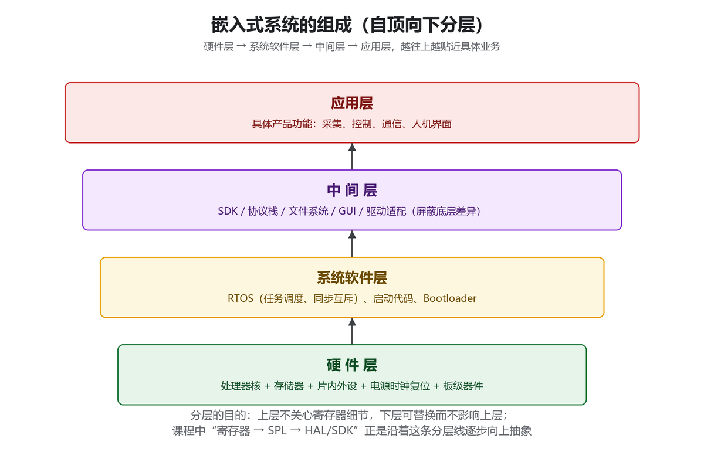

*图 5-1　嵌入式系统的分层组成*

嵌入式系统由**硬件**和**软件**两大部分组成，从下往上可以分成四层：

#### （1）硬件层——系统的物理基础

- **处理器（核心）**：MCU / MPU / DSP / SoC，如 STM32F103、i.MX6、ESP32；
- **存储器**：片内 Flash（存程序）、SRAM（存运行数据）、外部扩展的 EEPROM、SDRAM、SD 卡；
- **片内外设与接口**：GPIO、UART、I2C、SPI、CAN、USB、ADC/DAC、定时器、PWM 等；
- **外围电路**：电源管理、复位电路、晶振时钟、启动配置、调试接口；
- **板级器件**：LED、按键、传感器、电机驱动、显示屏、通信模块（WiFi/4G/蓝牙）。

#### （2）系统软件层——让硬件"能用"

- **启动代码（Bootloader）**：上电后初始化栈指针、搬运 `.data` 段、清零 `.bss` 段、跳转到 `main()`；产品中常带 IAP 升级功能；
- **设备驱动 / BSP（板级支持包）**：把寄存器操作封装成 `led_on()`、`uart_send()` 这样的接口，是"硬件与软件的边界"；
- **嵌入式操作系统（RTOS）**：FreeRTOS、RT-Thread、μC/OS、Linux 等，负责任务调度、同步互斥、内存管理、中断管理。

#### （3）中间层——屏蔽差异、复用能力

- **SDK / 协议栈**：如本课程《中间层-SDK 协议说明》中描述的、设备与物联网平台之间的 JSON 通信协议；
- **文件系统**：FATFS、LittleFS、SPIFFS；
- **图形库**：LVGL、emWin、μGUI；
- **通信协议库**：TCP/IP（lwIP）、Modbus、MQTT、BLE 协议栈。

#### （4）应用层——实现产品功能

面向具体业务：数据采集、逻辑控制、人机交互、网络上报、故障处理。这一层只调用中间层提供的接口，不直接碰寄存器。

> **分层的意义**：上层不关心寄存器细节，下层可替换而不影响上层。本作业里的"寄存器 → SPL → HAL"正是沿着这条分层线往上抽象；硬件换代时，改的只是最下面一层。

### 5.4 分类

- **按实时性**：硬实时（安全气囊、电机控制）、软实时（视频播放、数据采集）、非实时（智能家电的人机界面）；
- **按复杂度**：无操作系统（裸机前后台，本作业即属此类）、RTOS、通用操作系统（Linux/Android）；
- **按应用领域**：消费电子、工业控制、汽车电子、医疗电子、航空航天、物联网终端。

---

## 六、常见的处理器封装

**封装（Package）** 是芯片裸片（Die）外面的壳：它保护晶圆免受机械损伤与污染，把裸片上的焊盘（Pad）用**键合线（Wire Bond）**或**倒装焊（Flip-Chip）**引到外部引脚，同时负责散热。封装直接决定了芯片能不能焊、好不好修、能引出多少 IO。

### 6.1 常见封装类型

| 封装 | 全称 | 引脚形态 | 引脚间距 | 典型引脚数 | 主要特点 |
|---|---|---|---|---|---|
| **DIP** | Dual In-line Package | 两侧双排直插长脚 | 2.54 mm | 8–64 | 最古老，可直接插面包板或插座 |
| **SOP / SOIC** | Small Outline Package | 两侧双排鸥翼脚（贴片） | 1.27 mm | 8–28 | DIP 的贴片缩小版，最常见的"小芯片"封装 |
| **TSSOP / SSOP** | Thin/Shrink SOP | 两侧双排细密鸥翼脚 | 0.65 mm | 8–56 | 比 SOP 更薄更密，常用于存储器、接口芯片 |
| **QFP** | Quad Flat Package | **四边**鸥翼脚 | 0.4–0.8 mm | 32–208 | 四边出脚，引脚数大、可手工焊；细分 LQFP（薄）、TQFP（薄）、PQFP（塑封厚） |
| **QFN / DFN** | Quad/Dual Flat No-lead | 四边/两边**无脚**，底部焊盘 | 0.4–0.8 mm | 8–100 | 体积最小、散热好、寄生电感小；底部散热焊盘需回流焊 |
| **PLCC** | Plastic Leaded Chip Carrier | 四边 J 形内弯脚 | 1.27 mm | 20–84 | 可插专用插座，便于更换（老式 BIOS 芯片） |
| **BGA** | Ball Grid Array | 底面**锡球阵列** | 0.5–1.27 mm | 100–2000+ | 引脚数最多、电气性能最好；必须 X 光检测，返修困难 |
| **LGA** | Land Grid Array | 底面**金属焊盘** | 0.5–1.0 mm | 数十–上千 | 无焊球，靠焊盘接触/焊接，比 BGA 薄 |
| **PGA** | Pin Grid Array | 底面**针脚阵列** | 2.54 mm | 100–500 | 可插拔（老式 CPU） |
| **CSP / WLCSP** | Chip Scale Package | 接近裸片尺寸的球栅 | 0.3–0.5 mm | 少数–上百 | 封装面积≈裸片面积（≤1.2 倍），用于手机等极致小型化场合 |
| **COB** | Chip On Board | 裸片直接粘在 PCB 上打线 | — | — | 成本最低，常见于廉价电子表、玩具，不可维修 |

### 6.2 优缺点对比

| 封装 | 优点 | 缺点 | 典型应用 |
|---|---|---|---|
| DIP | 易插拔、易手工焊、可上插座 | 体积大、引脚少、频率特性差 | 教学实验、老式 51 单片机、运放 |
| SOP/SOIC | 体积小、焊接容易、成本低 | 引脚数受限、散热一般 | 电源芯片、EEPROM、逻辑器件 |
| QFP/LQFP | 引脚数多、四边出脚便于布线、可手工拖焊 | 脚细易弯、占板面积较大、0.4 mm 间距需助焊剂 | **STM32F103ZET6（LQFP144）**、大多数 MCU |
| QFN | 体积最小、散热与高频性能好、成本低 | 无引脚难以目视检查、必须回流焊、难返修 | 无线模块、传感器、小体积 MCU |
| BGA | 引脚密度最高、电气性能最优、散热好 | 需 X 光/飞针检测，个人无法返修 | FPGA、CPU、DDR 内存、手机 SoC |
| CSP | 极致小型化 | 工艺要求极高、几乎不可维修 | 智能手表、TWS 耳机 |

### 6.3 选型时看什么

1. **引脚数够不够**：功能升级常常先被 IO 数量卡住（这就是本作业芯片选 144 脚 Z 的原因）；
2. **能不能焊**：实验室手工焊首选 LQFP（0.5 mm 间距可拖焊），QFN/BGA 需要钢网 + 回流焊；
3. **散热**：大电流、高主频要选带**底部散热焊盘**的 QFN 或 BGA；
4. **体积与成本**：消费类产品优先 QFN/CSP，工业产品更看重可靠性与可维修性；
5. **信号完整性**：高速信号（USB、SDIO、SDRAM）优先 BGA，走线短、寄生参数小。

> STM32 同一颗芯片常提供多种封装（如 STM32F103 有 T=36 脚、C=48 脚、R=64 脚、V=100 脚、Z=144 脚、I=176 脚），**内核完全相同，只是引出的 IO 和外设数量不同**——这也是第八题命名规则里"引脚数字段"的意义。

---

## 七、最小硬件系统

### 7.1 定义

**最小硬件系统（最小系统）** 是指：**能让微控制器正常上电、运行程序并完成程序下载调试的、必不可少的**那一部分电路。

关键词是"**必不可少**"——去掉任何一部分，芯片就无法正常工作；而 LED、按键、显示屏、传感器这些"能拔掉还不影响芯片运行"的器件，都属于**应用外设**，不算最小系统。

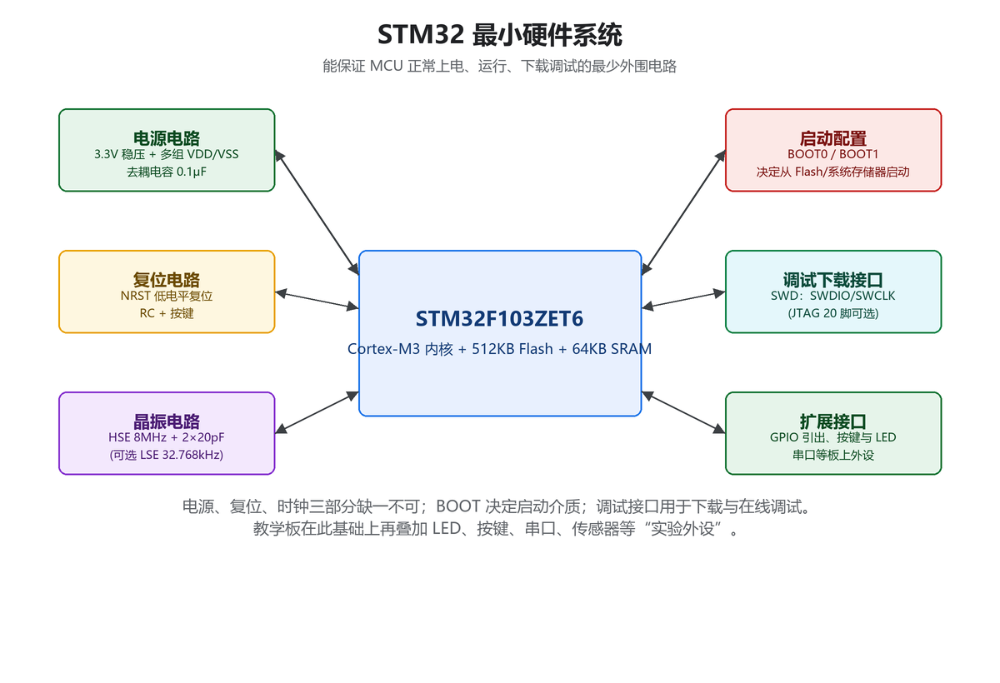

*图 7-1　STM32 最小硬件系统组成*

### 7.2 各组成部分

#### （1）电源电路

| 项目 | 要求 |
|---|---|
| 供电电压 | STM32F103 为 **2.0 V ~ 3.6 V**，典型 **3.3 V** |
| 引脚 | 多组 `VDD`/`VSS`（144 脚封装有 4 组以上）必须**全部**接电源和地，不能只接一组 |
| 去耦电容 | **每个 VDD 引脚就近放一个 0.1 μF 陶瓷电容**，整板再并一个 4.7~10 μF 钽电容滤低频 |
| 模拟电源 | `VDDA` 与 `VSSA` 单独供电，经**磁珠或 LC 滤波**后再接 3.3 V，否则 ADC 采样会跳 |
| 后备电源 | `VBAT` 接 3 V 纽扣电池，掉电后保住 RTC 与备份寄存器；不用时可经 100 nF 接地或接 VDD |
| 上电顺序 | 无特殊要求，但建议 VDD 与 VDDA 同时上电，避免模拟部分倒灌 |

#### （2）复位电路

- STM32 的 `NRST` 引脚**内部已有约 40 kΩ 上拉**，外部只需接一个 **100 nF 电容到地**（滤除毛刺、延长复位时间）+ 一个**按键到地**（手动复位）；
- 更可靠的做法是加专用复位芯片（如 MAX809），实现**电压监测复位**：电源低于阈值时强制拉低 NRST，防止低压下程序跑飞；
- 复位时间是硬件设计要核对的参数：电容太大会导致上电复位过慢，太小则抗干扰差。

#### （3）时钟电路

| 时钟源 | 电路 | 用途 |
|---|---|---|
| **HSE**（高速外部） | 8 MHz 石英晶振 + 2 个 20 pF 负载电容，尽量靠近芯片 | 经 PLL ×9 得到 72 MHz 系统主频，精度高 |
| **LSE**（低速外部） | 32.768 kHz 晶振 + 2 个 10~15 pF 电容 | RTC 实时时钟走时 |
| **HSI / LSI**（内部） | 无需外部器件 | 内部 8 MHz RC 振荡器，精度差（±1%），可作 HSE 起振失败的 fallback |

> 晶体下方要**铺地并禁止走线**，负载电容的接地端要就近回到芯片 GND，否则容易不起振或频率偏移。

#### （4）启动配置（BOOT0 / BOOT1）

STM32F103 上电时会锁存 `BOOT0` 与 `BOOT1`（PB2）的电平，决定从哪里开始执行：

| BOOT0 | BOOT1 | 启动区域 | 用途 |
|---|---|---|---|
| 0 | × | 主 Flash（`0x08000000`） | **正常运行用户程序**（最常见） |
| 1 | 0 | 系统存储器（ISP 引导程序） | 通过 USART1 串口下载程序（ST 出厂固化的 Bootloader） |
| 1 | 1 | 内置 SRAM | 调试用，掉电即失 |

BOOT0 一般经 **10 kΩ 下拉电阻接地**保证默认从 Flash 启动，需要串口下载时再用跳线帽接高。

#### （5）调试下载接口

| 接口 | 引脚 | 说明 |
|---|---|---|
| **SWD**（推荐） | `SWDIO`=PA13、`SWCLK`=PA14、GND、3.3V | 只需 4 根线，占用引脚少，支持下载与在线调试 |
| JTAG | PA13–PA15、PB3、PB4 共 5 根 | 老式 20 脚接口，占引脚多，现已少用 |

调试接口的 4 根线建议**加 22~100 Ω 串联电阻并就近放 TVS/ESD 保护**，防止热插拔打坏 IO。

#### （6）必要的"软"配置

最小系统能跑起来，除了硬件，还依赖两类软件配置：**启动文件**（`startup_stm32f10x_hd.s` 提供向量表和 `Reset_Handler`，其中向量表第 0、1 项分别是初始栈顶与复位入口）与**系统时钟初始化**（`SystemInit()` 配置 PLL）。本作业中 `boot/` 目录承担的就是这部分，复位后 SP/PC 如何被赋值详见 9.7 节。

### 7.3 最小系统与完整产品的关系

```text
最小系统（电源 + 复位 + 时钟 + 启动配置 + 调试接口 + MCU）
      ↓ 加上"应用外设"
完整产品硬件（LED 指示、按键输入、传感器采集、通信模块、电机驱动、显示屏）
      ↓ 加上"软件"
完整嵌入式产品（驱动 + 中间件 + 应用逻辑）
```

本作业的 LED 就是挂在最小系统之上的**第一个应用外设**：最小系统保证 MCU 能跑，`led_init()` 让 PA8 输出高低电平去驱动它。

---

## 八、STM32F103ZET6 的命名规则

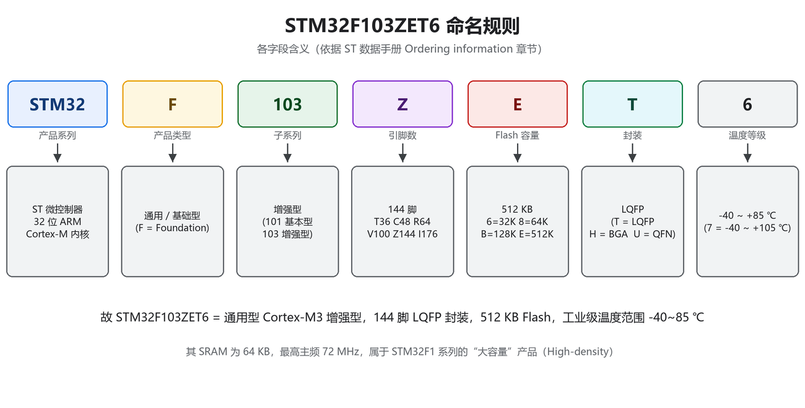

*图 8-1　STM32F103ZET6 各字段含义*

ST 的 MCU 型号由若干字段拼接而成，逐段拆开如下：

| 字段 | 含义 | 本例取值 | 说明 |
|---|---|---|---|
| `STM32` | 产品系列 | STM32 | **ST** = 意法半导体；**M** = Microcontroller（微控制器）；**32** = 32 位 |
| `F` | 产品类型 | F | F = 通用/基础型（Foundation）；L = 低功耗型；H = 高性能型；G = 主流型；W = 无线型 |
| `103` | 子系列 | 103 | 101 = 基本型，**103 = 增强型**（带 USB/CAN/SDIO），105/107 = 互联型（带以太网） |
| `Z` | 引脚数 | Z = **144 脚** | T=36，C=48，R=64，V=100，**Z=144**，I=176 |
| `E` | Flash 容量 | E = **512 KB** | 6=32K，8=64K，B=128K，C=256K，D=384K，**E=512K**，G=1M |
| `T` | 封装 | T = **LQFP** | T = LQFP，H = BGA，U = QFN/UFQFPN，Y = WLCSP |
| `6` | 工作温度 | 6 = **-40 ℃ ~ +85 ℃** | 6 = 工业级 -40~85 ℃，7 = 工业级 -40~105 ℃ |

### 8.1 结论

**STM32F103ZET6** = 意法半导体 32 位微控制器 · 通用型 F · 增强型 103 子系列 · 144 引脚 · 512 KB Flash · LQFP 封装 · 工业级温度 -40~85 ℃。

再结合数据手册补齐关键参数：

| 参数 | 数值 |
|---|---|
| 内核 | ARM Cortex-M3，最高 **72 MHz** |
| Flash / SRAM | **512 KB / 64 KB** |
| 封装 / 引脚 | LQFP144（0.5 mm 间距），可用 IO 约 112 个 |
| 工作电压 | 2.0 V ~ 3.6 V |
| 定时器 | 8 个（2 个高级 TIM1/TIM8 + 4 个通用 TIM2–5 + 2 个基本 TIM6/7），另有 2 个看门狗、SysTick、RTC |
| 通信接口 | 5×USART、3×SPI、2×I2C、1×CAN、1×USB、1×SDIO |
| 模拟外设 | 3×12 位 ADC（21 通道）、2×12 位 DAC |
| 其他 | FSMC 外部存储器接口、RTC、独立/窗口看门狗、CRC、96 位唯一 ID |

### 8.2 易混淆的相近型号

| 型号 | 与 ZET6 的差别 |
|---|---|
| STM32F103**ZCT6** | 只有 256 KB Flash（C），其余相同 |
| STM32F103**VET6** | 100 脚（V），可用 IO 从 112 个减少到约 80 个 |
| STM32F103**C8T6** | 48 脚（C）+ 64 KB Flash（8）+ 20 KB SRAM，最常见的"最小系统板" |
| STM32F103ZET6**TR** | 后缀 TR 表示**编带包装（Tape & Reel）**，芯片本身相同 |
| STM32F103ZET6**xxx** | 后缀表示温度等级/包装/出厂状态，选型时要核对完整订货号 |

> 记忆技巧：**"系列—类型—子系列—引脚—容量—封装—温度"**，共 7 段。选型时先定"要多少 IO"（引脚字段），再定"程序多大"（容量字段），最后核对封装与温度。

---

## 九、Cortex-M3 寄存器组的组成与作用

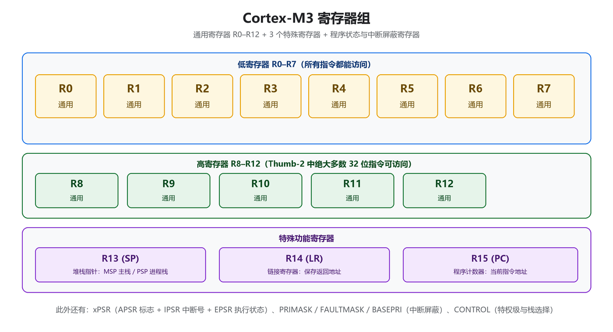

*图 9-1　Cortex-M3 寄存器组*

Cortex-M3 的寄存器组是**内核**里的高速存储单元，共 **16 个 32 位通用/专用寄存器（R0–R15）**，外加若干程序状态与控制寄存器。理解它们是看懂启动代码、中断现场和 RTOS 任务切换的前提。

### 9.1 通用寄存器 R0–R12

| 寄存器 | 别名 | 作用 |
|---|---|---|
| **R0–R7** | 低寄存器 | 通用数据寄存器。**所有 16 位 Thumb 指令都能访问**，因此编译器优先把最常用的变量放在这里 |
| **R8–R12** | 高寄存器 | 通用数据寄存器。只有部分 32 位 Thumb-2 指令能访问，所以使用频率低于低寄存器 |

它们的作用就是"放操作数和运算结果"：做加法时两个操作数先进 R0/R1，结果写回 R0。函数调用时，**R0–R3 用来传递前 4 个参数，返回值放在 R0**（这是 AAPCS 调用约定，任何编译器都遵循）。

### 9.2 三个特殊功能寄存器

| 寄存器 | 名称 | 作用 |
|---|---|---|
| **R13** | **SP（Stack Pointer，堆栈指针）** | 指向当前栈顶，栈是**满递减**（Full Descending）的，即压栈时先减地址再写。Cortex-M3 有**两个物理栈指针**：`MSP`（主栈指针，用于异常/中断处理和复位后的代码）与 `PSP`（进程栈指针，通常给 RTOS 的用户任务用）。同一时刻只有一个生效，由 `CONTROL[1]`（SPSEL）选择。上电复位后默认使用 MSP |
| **R14** | **LR（Link Register，链接寄存器）** | 保存**函数返回地址**。执行 `BL`（带链接跳转）时硬件自动把下一条指令地址存入 LR；函数返回时 `BX LR` 即可跳回。若函数里还要再调用别的函数，编译器会先把 LR 压栈保存 |
| **R15** | **PC（Program Counter，程序计数器）** | 指向**当前正在取指的指令地址**，每取一条指令自动递增（16 位指令 +2，32 位指令 +4）。读 PC 得到的是"当前指令地址 + 4"（三级流水线导致的偏移），写 PC 即实现跳转 |

> 补充：R13 的两个栈指针在物理上是**同一编号的两个寄存器（banked register）**，异常进入时硬件自动切换——这正是 Cortex-M3 能快速响应中断的原因之一。

### 9.3 程序状态寄存器 xPSR

`xPSR` 是三个寄存器"拼"在一起的组合视图（**组合**而非物理独立）：

| 组成 | 全称 | 位数 | 作用 |
|---|---|---|---|
| **APSR** | Application Program Status Register | bit31–28 为 NZCV，bit27 为 Q | 条件标志：**N**（负）、**Z**（零）、**C**（进位/借位）、**V**（溢出）；另有 Q（饱和）标志。`CMP` 之后判断 `if (a > b)` 就靠它们 |
| **IPSR** | Interrupt Program Status Register | 低 9 位 | 记录**当前正在执行的异常/中断编号**（0 = 线程模式，1 = 复位，2 = NMI，3 = 硬故障，…，16 起为外设中断）。通过读 IPSR 可判断"现在在哪个中断里" |
| **EPSR** | Execution Program Status Register | 位 24–31 等 | 记录执行状态，其中 **T 位（Thumb 位）恒为 1**（Cortex-M 只支持 Thumb 状态）；还保存 `IT`（If-Then 指令块状态）与中断继续标志。EPSR 只能间接读写 |

### 9.4 中断屏蔽与控制寄存器

这三个寄存器直接决定"中断能不能响应"，是编写临界区代码的工具：

| 寄存器 | 位数 | 作用 | 典型用法 |
|---|---|---|---|
| **PRIMASK** | 1 位 | 置 1 后**屏蔽所有可屏蔽中断**，只剩 NMI 和硬故障（HardFault） | 临界区保护：`__disable_irq()` / `__enable_irq()` |
| **FAULTMASK** | 1 位 | 置 1 后**连硬故障也屏蔽**（只剩 NMI） | 极少用，仅用于故障处理程序的最后阶段 |
| **BASEPRI** | 8 位 | 设定**优先级阈值**：优先级数值 ≥ 阈值的所有中断都被屏蔽 | RTOS 的临界区：只屏蔽低优先级中断，保证高优先级中断的实时性（比 PRIMASK 更精细） |
| **CONTROL** | 2~3 位 | bit0 **nPRIV**：0 = 特权模式，1 = 用户模式；bit1 **SPSEL**：0 = 使用 MSP，1 = 使用 PSP | 复位后为特权模式 + MSP；RTOS 启动第一个任务时切到用户模式 + PSP |

### 9.5 一张表总结

| 寄存器 | 位宽 | 是否分组（banked） | 一句话作用 |
|---|---|---|---|
| R0–R12 | 32 | 否 | 通用数据寄存器，放操作数与结果 |
| R13 (SP) | 32 | **是**（MSP / PSP） | 堆栈指针，满递减，8 字节对齐 |
| R14 (LR) | 32 | 否 | 保存函数返回地址 |
| R15 (PC) | 32 | 否 | 当前指令地址，写 PC 即跳转 |
| xPSR | 32 | 否 | 标志位 + 当前中断号 + Thumb 状态 |
| PRIMASK | 1 | 否 | 屏蔽所有可屏蔽中断 |
| FAULTMASK | 1 | 否 | 连硬故障也屏蔽（只剩 NMI） |
| BASEPRI | 8 | 否 | 按优先级阈值屏蔽中断 |
| CONTROL | 2~3 | 否 | 选择特权级与使用哪个栈指针 |

### 9.6 特殊寄存器怎么访问？——MRS / MSR 与工作模式

PRIMASK、FAULTMASK、BASEPRI、CONTROL、xPSR **没有存储器地址**，不能用普通的 `LDR/STR` 访问，只能用两条专用指令：

```asm
MRS  R0, PRIMASK        ; 读：把 PRIMASK 的值读到通用寄存器 R0
MSR  PRIMASK, R0        ; 写：把 R0 的值写进 PRIMASK
MSR  CONTROL, R1        ; 写 CONTROL（切换栈指针 / 进入用户模式）
MRS  R0, PSR            ; 读组合后的 xPSR（APSR|IPSR|EPSR）
```

C 语言里不用手写汇编，CMSIS 已经封装好了：`__get_PRIMASK()` / `__set_PRIMASK()`、`__get_CONTROL()` / `__set_CONTROL()`、`__get_IPSR()`（判断当前在哪个中断）、`__get_MSP()` / `__get_PSP()`、`__disable_irq()` / `__enable_irq()`。

这几个寄存器之所以重要，是因为它们决定了 **Cortex-M3 的工作模式与工作状态**：

| 概念 | 取值 | 由谁决定 | 说明 |
|---|---|---|---|
| **工作模式** | 线程模式（Thread） | 不在异常中 | 执行普通用户程序 |
| | 异常模式（Handler） | 正在处理异常/中断 | 特权级，使用 MSP，可访问全部资源 |
| **工作状态（权限）** | 特权级（Privileged） | `CONTROL[0] = 0` | 可用于异常处理和关键代码，能访问所有寄存器 |
| | 用户级（User） | `CONTROL[0] = 1` | 受限，不能直接改 CONTROL，必须靠异常（如 `SVC`）回到特权级 |
| **使用哪个栈** | MSP | `CONTROL[1] = 0` | 复位默认；异常处理固定用 MSP |
| | PSP | `CONTROL[1] = 1` | RTOS 给每个任务分配独立 PSP，切换任务即切换 PSP |

**状态转换要点**：复位后一定是"线程模式 + 特权级 + MSP"；进入异常自动切到"异常模式 + 特权级 + MSP"；在用户级想回到特权级，只能通过触发异常（`SVC` 指令）让硬件切回去。RTOS 就是利用这套机制让用户任务跑在 PSP + 用户级，从而把任务隔离起来。

### 9.7 复位时 SP 与 PC 是怎么来的？

这是理解启动文件的关键。系统复位后，内核**还没有执行任何指令**，它做的第一件事是自动从存储器读两个字：

| 读取地址 | 内容 | 写入 |
|---|---|---|
| `0x00000000` | 初始栈顶值（向量表第 0 项，即 `__initial_sp`） | **SP（R13）** |
| `0x00000004` | 复位向量（向量表第 1 项，即 `Reset_Handler` 的地址） | **PC（R15）** |

所以 `startup_stm32f10x_hd.s` 里的向量表必须把"栈顶"放在最前、"复位处理函数"放在第二项；然后 `Reset_Handler` 才做后续工作：调用 `SystemInit()` 配置时钟 → 搬运 `.data` 段→ 清零 `.bss` 段 → `BL main` 进入 C 世界。理解了这两个字，就明白为什么"栈顶地址不对"会直接导致上电就跑飞。

> ⚠️ **两个易错点**：① ARM 规定栈必须 **8 字节对齐**（AAPCS 要求），所以中断压栈时若 SP 未对齐会自动补一个字；② 进入异常时硬件**只自动压栈 8 个寄存器**（R0–R3、R12、LR、PC、xPSR），R4–R11 需要由中断服务程序自己保存——这就是 RTOS 做任务切换时"手工保存剩余寄存器"的原因。
